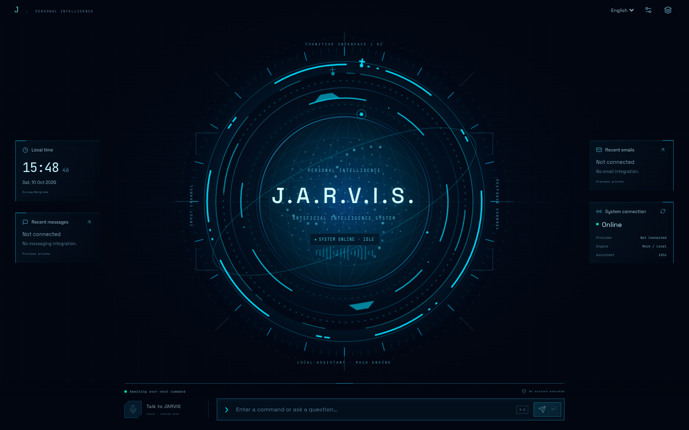
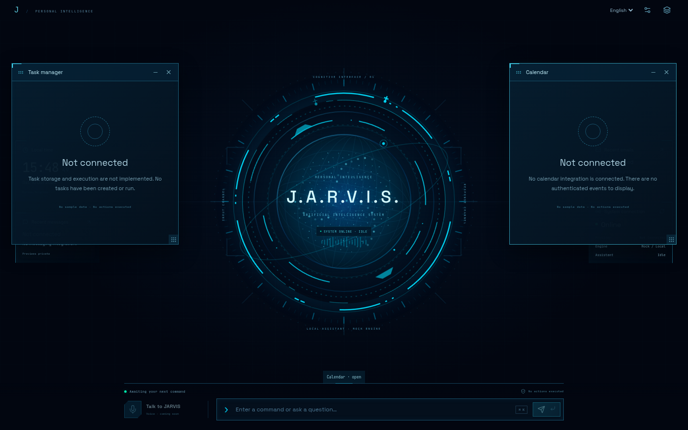

# JARVIS — personal assistant for macOS

Milestone 1 is a local React + TypeScript command center connected to a Python FastAPI backend. It uses deterministic mock responses and requires **no API keys**. No microphone access, computer actions, external AI calls, or persistent memory are implemented.

## Milestone 1 checklist

- [x] React + TypeScript + Vite interface with responsive holographic styling
- [x] Backend health and assistant status, displayed from live API responses
- [x] On-demand conversation window connected to a mock-response endpoint
- [x] Serbian/English selector, local UI commands, and mock responses
- [x] Disabled microphone control, real connection status, session command history
- [x] Environment configuration, JSON request logging, backend and frontend tests
- [x] Modular service boundary and macOS installation instructions
- [ ] Validate natively on macOS (cloud development host is Linux)

## Structure

```text
backend/
  app/             # config, JSON logging, API routes, mock assistant service
  tests/           # endpoint, validation, CORS and configuration tests
  requirements.txt
frontend/
  src/
    components/    # SVG core, HUD panels, command console, holographic windows
    hooks/         # session/API state, window management, visibility
    styles/        # core motion and rendering styles
    commands.ts    # deterministic English/Serbian UI intent parser
    api.ts         # existing typed API client
    copy.ts        # English/Serbian interface copy
  package-lock.json
```

The assistant service is the future integration point for model providers. Add speech, memory, and computer automation as separate services; automation will need explicit user approval before executing actions. Milestone 1 does not expose an action execution endpoint.

## Minimal holographic command center



The permanent centerpiece is a large animated SVG intelligence core with segmented rings, orbital paths, radial ticks, geometric structures, and 180 procedural particles. Four compact HUD panels show local time/date, messaging availability, email availability, and real backend/provider status. The browser uses your Mac’s local timezone. Messages and email show **Not connected** without fabricated content or unread counts.

There is no permanent sidebar or chat window. Use the text console to summon modules:

| English | Serbian | Result |
| --- | --- | --- |
| Jarvis, bring up my task list. | Jarvise, prikaži zadatke. | Open Task Manager |
| Jarvis, show my calendar. | Jarvise, otvori kalendar. | Open Calendar |
| Jarvis, display my emails. | Jarvise, prikaži mejlove. | Expand email window |
| Jarvis, show my conversations. | Jarvise, prikaži razgovore. | Show session chat and command history |
| Jarvis, open settings. | Jarvise, otvori podešavanja. | Open settings |
| Jarvis, close the task list. | Jarvise, zatvori zadatke. | Close Task Manager |
| Jarvis, close all windows. | Jarvise, zatvori sve prozore. | Restore minimal home |

Known UI commands use a deterministic allowlist locally, including while the backend is offline. Unknown text uses the existing mock assistant endpoint; commands never execute JavaScript, shell commands, or computer actions. Serbian Cyrillic is also supported. Future speech-to-text can feed this same validated router; voice recognition is not implemented and the microphone button is disabled.

Windows support focus, close, minimize/restore, multiple open modules, and desktop dragging/resizing within the visible stage. Focus the title or resize handle and use arrow keys (Shift for larger steps) as keyboard alternatives. Smaller screens stack windows below the core. Opening and closing use approximately 320 ms holographic assembly transitions. A compact top menu also summons windows, and settings provide motion and integration-preview privacy controls. Integration previews default to private; no authenticated integration data is available yet.



Conversations retain the existing session messages, safe code rendering, timestamps, and command history until page reload. A backend reply briefly appears above the console; open Conversations to review it afterward. Tasks, calendar, email, messages, agents, memory, tools, and workflows are honest availability views: no storage, integrations, or automation have been added.

The core reflects idle, processing, responding, and error/offline states. A separate listening visual state is reserved for future integration. **Command-K** (Control-K also works) focuses the command input; **Enter** submits. Animations respect reduced-motion preferences, can be disabled in settings, and pause with health polling when the tab is hidden. The particle field is decorative geometry, not live model telemetry. Fonts are bundled locally.

## Run on your Mac

Prerequisites: Git, Python **3.11+**, and Node.js **22.12+** with npm. If using Homebrew, `brew install python@3.12 node` installs suitable runtimes. Use the Python from Homebrew rather than relying on Apple's system Python.

```bash
git clone https://github.com/udiicc/Jarvis-ai.git
cd Jarvis-ai
python3 -m venv .venv
source .venv/bin/activate
python -m pip install -r backend/requirements.txt
npm ci --prefix frontend
```

If you already have a checkout, use it instead of cloning again. These implementation changes must be in your checkout before the commands above can run.

Terminal 1, from the repository root:

```bash
source .venv/bin/activate
cd backend
python -m uvicorn app.main:app --host 127.0.0.1 --port 8000 --reload
```

Terminal 2, from the repository root:

```bash
cd frontend
npm run dev
```

Once the servers are running on your Mac, open `http://localhost:5173`. The backend API documentation is at `http://127.0.0.1:8000/docs`. Stop each server with Control-C. The UI checks backend health every 10 seconds; if offline, backend chat is disabled while local window commands remain available. A failed chat request is reported in the UI and command history.

## Configuration

Defaults work without any environment files. The browser uses same-origin /api requests through Vite. This also supports a forwarded frontend when the hosting platform provides forwarding; this Codex onboarding environment does not expose a public Web preview. For a separately deployed backend address:

```bash
cp frontend/.env.example frontend/.env.local
# Edit VITE_API_BASE_URL, then restart Vite.
```

Frontend variables are public; never place secrets in `VITE_` variables. `backend/.env.example` documents shell variables; it is not loaded automatically. For example, in Terminal 1 before starting the backend:

```bash
export JARVIS_LOG_LEVEL=INFO
export JARVIS_ALLOWED_ORIGINS='http://localhost:5173,http://127.0.0.1:5173'
```

JSON backend logs go to stderr and include request method, path, status, and duration. They exclude chat bodies. CORS permits the configured local frontend origins. The backend binds to loopback. Vite listens on 0.0.0.0:5173 and proxies /api to the backend, so remote previews need only frontend port 5173. This is a development foundation, not a public deployment with authentication. Avoid exposing it on untrusted networks.

## Verification

From the repository root:

```bash
(cd backend && ../.venv/bin/python -m pytest -q)
npm test --prefix frontend
npm run build --prefix frontend
curl --fail http://127.0.0.1:8000/api/health
curl --fail http://127.0.0.1:8000/api/assistant/status
curl --fail http://127.0.0.1:8000/api/chat \
  -H 'Content-Type: application/json' \
  -d '{"message":"Zdravo","language":"sr"}'
```

The API requests require the backend to be running. Test installation with `npm ci`, which uses the committed lockfile. Chat and command history live only in browser state and clear on reload. Telemetry describes application capabilities and session events, not Mac CPU or memory usage. Voice, persistent memory, real AI, and approved automation belong to later milestones.

### Redesign validation

Frontend tests cover the minimal default layout, hidden modules, English/Serbian command routing, window state and keyboard controls, retained chat/history, language, offline and failure behavior, request states, manual recovery, motion controls, and safe code rendering. Backend endpoint tests remain unchanged.

Validation passed: **36 frontend tests**, **7 backend tests**, TypeScript checks, and the production build. Chromium checks at 1440×900, 1280×800, 1920×1080, 1024×768, 800×800, and 390×844 found no horizontal overflow. Browser checks exercised local commands without backend requests, real English/Serbian mock chat, window dragging/clamping, resizing, minimize/restore, close-all, mobile stacking, the local timezone clock, reduced motion, and opening windows with motion disabled. Native macOS/Safari testing remains outstanding.
