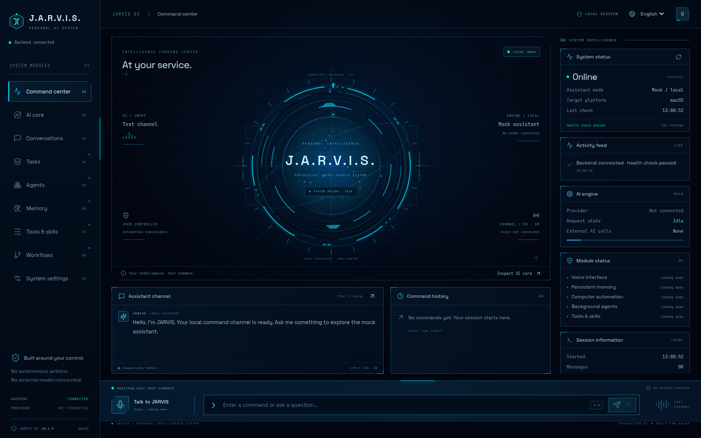

# JARVIS — personal assistant for macOS

Milestone 1 is a local React + TypeScript dashboard connected to a Python FastAPI backend. It uses deterministic mock responses and requires **no API keys**. No microphone access, computer actions, external AI calls, or persistent memory are implemented.

## Milestone 1 checklist

- [x] React + TypeScript + Vite dashboard with responsive futuristic styling
- [x] Backend health and assistant status, displayed from live API responses
- [x] Chat panel connected to a mock-response endpoint
- [x] Serbian/English selector (main chat copy and mock responses; some dashboard labels remain English)
- [x] Microphone placeholder, system cards, session command history
- [x] Environment configuration, JSON request logging, backend and frontend tests
- [x] Modular service boundary and macOS installation instructions
- [ ] Validate natively on macOS (cloud development host is Linux)

## Structure

```text
backend/
  app/             # config, JSON logging, API routes, mock assistant service
  tests/           # endpoint, validation, CORS and configuration tests
  requirements.txt
frontend/
  src/
    components/    # shell, SVG core, command console, conversations, telemetry
    hooks/         # session/API state, navigation, visibility
    styles/        # core motion and rendering styles
    api.ts         # existing typed API client
    copy.ts        # English/Serbian interface copy
  package-lock.json
```

The assistant service is the future integration point for model providers. Add speech, memory, and computer automation as separate services; automation will need explicit user approval before executing actions. Milestone 1 does not expose an action execution endpoint.

## Cinematic command center



The interface uses the supplied SVG reference as visual inspiration, with original SVG geometry and local fonts (Space Grotesk and JetBrains Mono). It makes no external font or model requests.

- **Command center:** holographic core, compact conversation channel, and recent command history.
- **AI core:** a larger inspection view. Segmented orbits, radial ticks, particles, the intelligence sphere, and an elliptical orbit are rendered live with SVG and CSS.
- **Conversations:** expanded session messages with timestamps, safe fenced-code rendering, and command history. Messages survive navigation and clear on page reload.
- **System settings:** session motion controls and a manual backend health check. The top-bar language selector controls navigation, primary chat copy, and mock response language; some technical labels remain English.
- **Tasks, agents, memory, tools, workflows:** informative Coming Soon views. They do not run actions or enable future capabilities.

The core reflects real connection/request states: connecting, idle, processing, responding after a received reply, offline, and request error. A listening visual state exists only for future integration; nothing activates it or requests microphone access. The Talk control opens an explanatory notice.

Use **Command-K** (Control-K also works) to focus the command input, and **Enter** to send. Navigation supports URL hashes and browser back/forward. At smaller widths the telemetry column collapses; on phones use the menu button to open navigation, and Escape to close it. The command console remains accessible while scrolling.

Animations respect `prefers-reduced-motion`, can be paused in settings, and pause automatically when the tab is hidden. Health polling also pauses in hidden tabs and resumes on return. Request timestamps and activity come from actual session events; there are no simulated CPU/RAM statistics. The neural particle field is a procedural visual, not live AI model telemetry.

## Run on your Mac

Prerequisites: Git, Python **3.11+**, and Node.js **22.12+** with npm. If using Homebrew, `brew install python@3.12 node` installs suitable runtimes. Use the Python from Homebrew rather than relying on Apple's system Python.

```bash
git clone https://github.com/udiicc/Jarvis-ai.git
cd Jarvis-ai
python3 -m venv .venv
source .venv/bin/activate
python -m pip install -r backend/requirements.txt
npm ci --prefix frontend
```

If you already have a checkout, use it instead of cloning again. These implementation changes must be in your checkout before the commands above can run.

Terminal 1, from the repository root:

```bash
source .venv/bin/activate
cd backend
python -m uvicorn app.main:app --host 127.0.0.1 --port 8000 --reload
```

Terminal 2, from the repository root:

```bash
cd frontend
npm run dev
```

Once the servers are running on your Mac, open `http://localhost:5173`. The backend API documentation is at `http://127.0.0.1:8000/docs`. Stop each server with Control-C. The UI checks backend health every 10 seconds; if offline, chat sending is disabled. A failed chat request is reported in the UI and command history.

## Configuration

Defaults work without any environment files. The browser uses same-origin /api requests through Vite. This also supports a forwarded frontend when the hosting platform provides forwarding; this Codex onboarding environment does not expose a public Web preview. For a separately deployed backend address:

```bash
cp frontend/.env.example frontend/.env.local
# Edit VITE_API_BASE_URL, then restart Vite.
```

Frontend variables are public; never place secrets in `VITE_` variables. `backend/.env.example` documents shell variables; it is not loaded automatically. For example, in Terminal 1 before starting the backend:

```bash
export JARVIS_LOG_LEVEL=INFO
export JARVIS_ALLOWED_ORIGINS='http://localhost:5173,http://127.0.0.1:5173'
```

JSON backend logs go to stderr and include request method, path, status, and duration. They exclude chat bodies. CORS permits the configured local frontend origins. The backend binds to loopback. Vite listens on 0.0.0.0:5173 and proxies /api to the backend, so remote previews need only frontend port 5173. This is a development foundation, not a public deployment with authentication. Avoid exposing it on untrusted networks.

## Verification

From the repository root:

```bash
(cd backend && ../.venv/bin/python -m pytest -q)
npm test --prefix frontend
npm run build --prefix frontend
curl --fail http://127.0.0.1:8000/api/health
curl --fail http://127.0.0.1:8000/api/assistant/status
curl --fail http://127.0.0.1:8000/api/chat \
  -H 'Content-Type: application/json' \
  -d '{"message":"Zdravo","language":"sr"}'
```

The API requests require the backend to be running. Test installation with `npm ci`, which uses the committed lockfile. Chat and command history live only in browser state and clear on reload. Telemetry describes application capabilities and session events, not Mac CPU or memory usage. Voice, persistent memory, real AI, and approved automation belong to later milestones.

### Redesign validation

Frontend tests cover the existing chat, language, offline, and failure behavior, plus module navigation, retained conversations, core request states, manual recovery, keyboard input focus, session motion controls, and safe code rendering. Backend endpoint tests are unchanged.

The redesign was also checked in Chromium at 1440×900, 1280×800, 1920×1080, 1024×768, 800×800, and 390×844: no horizontal overflow; desktop core and command console remain visible. Browser checks exercised live English/Serbian API chat, module navigation, processing/responding/idle states, request errors, offline recovery, hidden-tab animation pause, and reduced motion. Native macOS/Safari testing remains outstanding.
